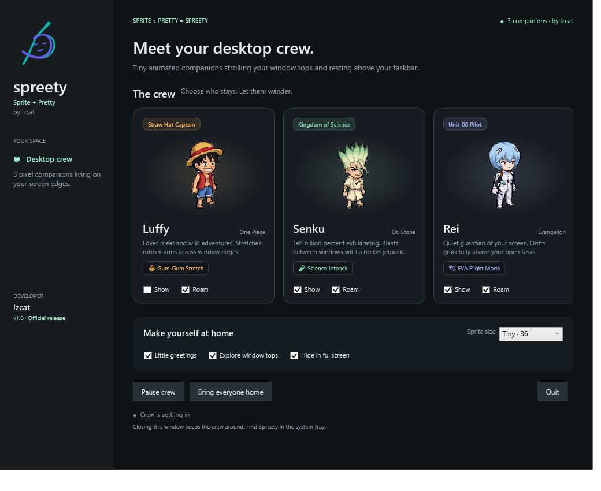

<div align="center">
  
  <h1>Spreety · v1.0</h1>
  <p><strong>Sprite + Pretty = Spreety</strong> · Crafted with love by <strong>lzcat</strong></p>
  <p><em>Tiny 2.5D pixel desktop companions for Windows</em></p>
</div>

Luffy, Senku, and Rei rest above your taskbar, greet you, wander across visible window tops, and travel with their own effects in retro 2.5D isometric pixel art with proper multi-frame walking cycles.



## Run

You can launch **`Spreety.exe`** directly from the repository root (outside the zip). Keep the `assets` folder beside the executable.

For final shipping or distribution to friends, use **`Spreety-v1-win-x64.zip`** (packaged in the root and `dist/`).

Requires Windows 10/11 x64 and .NET Framework 4.8. No Node, npm, administrator rights, or network connection is needed by the app.

The app is an unsigned local prototype. It does not install a service, register startup, modify desktop shortcuts, or send telemetry.

## Controls

- **Show** includes or hides that character.
- **Roam** allows walking and travel. Turn it off to keep that companion at its home perch; it can still idle and greet you.
- **Pause crew** freezes animation; resume uses the same button.
- **Bring everyone home** returns the crew to the primary screen's work-area bottom.
- **Little greetings**, **Explore window tops**, **Hide in fullscreen**, and three compact sprite sizes (**Tiny · 36**, **Cozy · 48**, **Classic · 64**) are configurable.
- Closing the panel keeps companions running. Double-click the tray icon to reopen it, or right-click for pause, home and quit.

Companion overlays pass mouse input through to the windows underneath. Preferences and error logs live in `%LOCALAPPDATA%\Spreety`.

## Build and test

Run from PowerShell:

```powershell
.\build.ps1
Start-Process .\bin\Spreety.exe -ArgumentList '--self-test' -Wait
Get-Content .\bin\test-results.txt
.\package.ps1
```

The build uses Windows' .NET Framework C# compiler and WPF assemblies.
- `build.ps1` builds `bin/Spreety.exe` and updates `Spreety.exe` directly in the root.
- `--preview` renders the panel into `bin/preview.png`, then exits.
- `--self-test` verifies all 15 sprite frames across all characters, state transitions, easing, and atomic settings recovery.

## Scope and features

- **2.5D Pixel Art**: 15 distinct animation frames across Luffy, Senku, and Rei (Idle, Walk Contact 1, Walk Passing, Walk Contact 2, Seated).
- **True Multi-Frame Walking Cycle**: Alternating foot contact animation and horizontal directional flipping (facing left or right based on movement direction).
- **Scaled-Down Proportions**: Default 48px height with pixel-art nearest-neighbor integer scaling, keeping the companions unobtrusive and crisp.
- **Window Top & Edge Perching**: Explores horizontal window tops and work-area perches with edge peeking and character-specific travel effects.

See [IDEA.md](IDEA.md) for the product vision, [DEVELOPMENT.md](DEVELOPMENT.md) for implementation history, and [docs/ARCHITECTURE.md](docs/ARCHITECTURE.md) for maintenance notes.
